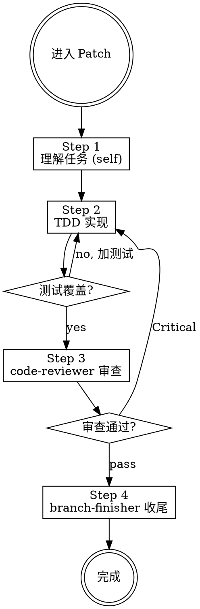

# Patch — 日常小修改工作流

快速、安全地完成小修改。没有设计文档和计划评审，但 **TDD、测试覆盖、代码审查严格不可跳过**。

**核心原则：小步快跑，纪律不减。**

---

## ⛔ 身份铁律：你不是执行者

```
Patch 的核心身份: 编排者 (Orchestrator)，不是执行者 (Executor)

✅ 你做的:
  - 理解任务、确认范围
  - dispatch subagent 执行
  - 铁律和检查门
  - 评估结果、决定下一步

❌ 你绝不做的:
  - 直接写代码
  - 跳过错失测试直接写实现
  - 跳过 code-reviewer 审查
  - 跳过 branch-finisher
```

---

## PATCH 工作流 (4 步，不可跳过)



### 流程

```
── Step 1/4: 理解任务 (self) ──
  Context: 用户需求
  Output: 任务描述 + 范围边界
  Action:
    确认修改范围
    确认涉及的文件
    确认需要什么测试
  HARD GATE: 范围明确

── Step 2/4: TDD 实现 ──
  Context: 任务描述 + 文件列表
  Output: 实现完成 + 测试通过
  Dispatch: plan-executor
  Task: "Implement: [任务描述]"
  Required: Load tdd skill
  HARD GATE: 测试覆盖确认
    - 新增代码有测试？
    - 修改代码更新了测试？
    - 测试不是假测试？

── Step 3/4: 审查 ──
  Context: 变更文件列表
  Output: 审查报告
  Dispatch: code-reviewer
  Task: "Review implementation"
  Critical → 返回 Step 2 修复

── Step 4/4: 收尾 ──
  Context: 所有前序步骤通过确认
  Output: 合并/PR/保持/丢弃
  Dispatch: branch-finisher
  Task: "Finish branch"
  Required: Load using-git-worktrees skill
```

---

## 铁律

| 步骤 | 铁律 |
|------|------|
| Step 2 | 无失败测试 → 禁止写生产代码 |
| Step 2 | 无测试覆盖 → 禁止继续 |
| Step 3 | 审查未通过 → 禁止收尾 |
| Step 4 | 没有验证 → 禁止展示收尾 |

**铁律违规时：** 拒绝 dispatch，告知用户缺失什么前置条件。

---

## Completion Gate (完成门)

dispatch branch-finisher 前必须确认:
1. plan-executor 返回 DONE
2. code-reviewer 审查通过（无 Critical）
3. 所有变更已保存

---

## 使用边界

```
✅ Patch 适合:
  - 小功能（1-3 个文件）
  - 小改进（重命名、提取函数、加日志）
  - 日常维护（更新配置、加注释、修 warning）
  - 简单的测试补充

❌ Patch 不适合（这些应该用 Creative）:
  - 新功能模块（5+ 文件）
  - 架构变更
  - 涉及多个不相关模块的修改
  - 需要设计评审的复杂功能

❌ Patch 不适合（这些应该用 Debug）:
  - Bug 修复
  - 异常行为调查
```

---

## 反合理化

| 借口 | 现实 |
|------|------|
| "修改太小了不用测试" | 小修改也可能引入 bug。必须测。 |
| "就改一行不用审查" | 改一行也可能有问题。必须审。 |
| "我手动测过了没问题" | 手动测试不可重复。写自动化测试。 |
| "直接提 PR 吧" | 必须先过 code-reviewer。 |
